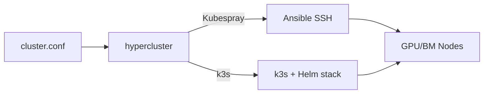

# hypercluster

**Bare-metal Kubernetes lifecycle over SSH.**

End-to-end cluster provisioning wrapper around **Kubespray** and **k3s** — deploy upstream Kubernetes with Podman runtime, Cilium, MetalLB, KubeVirt, and the full Zyvor platform stack. No cloud provider. No special agents.

```text
┌──────────────────────────────────────────────────────────────┐
│  CLI          hypercluster — deploy · upgrade · scale · test │
├──────────────────────────────────────────────────────────────┤
│  Paths        Kubespray (Ansible) · k3s platform stack       │
├──────────────────────────────────────────────────────────────┤
│  Day-2        forge · zeus-os · machina · packetwolf install │
└──────────────────────────────────────────────────────────────┘
```

---

## Why hypercluster

| Problem | hypercluster answer |
|---------|---------------------|
| Kubespray is powerful but raw | Opinionated wrapper with preflight + kubeconfig fetch |
| Lab clusters need KubeVirt too | k3s path installs Cilium + MetalLB + KubeVirt/CDI |
| Day-2 is a separate project | Documented Zyvor stack install order |
| macOS operators need local test | Desktop app + remote SSH deploy |
| No cloud, no problem | Pure SSH — bare metal, edge, air-gap |

**Scope:** Kubernetes lifecycle only. AI/observability stacks install *after* cluster via [platform stack guide](docs/guides/zyvor-platform-stack.md).

---

## Platform at a Glance

| Layer | What's in the repo |
|-------|-------------------|
| **CLI** | `hypercluster` bash orchestrator — root script |
| **Kubespray** | Ansible path — `.kubespray/`, `lib/` |
| **k3s stack** | Cilium, cert-manager, MetalLB, KubeVirt — `lib/k3s.sh` |
| **Desktop** | Electron cluster studio — `desktop/` |
| **Docs** | CLI guide, config reference, PDFs — `docs/` |
| **Tests** | Platform smoke tests — `tests/` |

---

## Quick Start

```bash
git clone https://github.com/ssahani/hypercluster.git && cd hypercluster
cp config/cluster.conf.example cluster.conf
# edit cluster.conf — nodes, SSH user, K8S_DISTRO

./hypercluster preflight
./hypercluster deploy
./hypercluster kubeconfig
./hypercluster test
```

**Remote k3s lab:**

```bash
./scripts/deploy-remote.sh HOST USER
```

| Scenario | Path |
|----------|------|
| First cluster tutorial | [README § Tutorial](README.md) |
| Zyvor platform stack | [docs/guides/zyvor-platform-stack.md](docs/guides/zyvor-platform-stack.md) |
| Desktop UX | [docs/guides/desktop-ux-guide.md](docs/guides/desktop-ux-guide.md) |
| Config reference | [docs/generated/CONFIG-REFERENCE.md](docs/generated/CONFIG-REFERENCE.md) |

---

## Architecture



---

## Documentation

| Goal | Document |
|------|----------|
| Docs index | [docs/README.md](docs/README.md) |
| User stories | [docs/USER_STORIES.md](docs/USER_STORIES.md) |
| Full CLI reference | [docs/generated/CLI.md](docs/generated/CLI.md) |
| Agent quickref | [docs/generated/AGENT-QUICKREF.md](docs/generated/AGENT-QUICKREF.md) |

## Zyvor Platform Stack

| Product | Role |
|---------|------|
| **hypercluster** | Bare-metal Kubernetes bootstrap |
| **machina** | Physical hypervisor OS (libvirt/KVM) |
| **zeus-os** | Cloud / KubeVirt control plane |
| **hermes** | Application layer for Kubernetes |
| **forge** | AI infrastructure on Kubernetes |
| **hypersdk / hyper2kvm** | Multi-cloud VM migration |
| **guestkit** | Offline VM migration assurance |
| **packetwolf** | Kernel-native network intelligence |
| **Aether** | Universal runtime portability |
| **Veyron** | KubeVirt VM command center |
| **IronWolf** | Metal3 bare-metal automation |
| **zyvor-fabric** | systemd-native private cloud |

→ [zyvor.dev](https://zyvor.dev)

---

## Development

See project docs for CI, testing, and contribution guidelines. Historical build summaries in the repo root are snapshots — **`docs/` and this README are authoritative.**

---

## License

See [LICENSE](LICENSE) or project-specific licensing files in `docs/legal/`.
