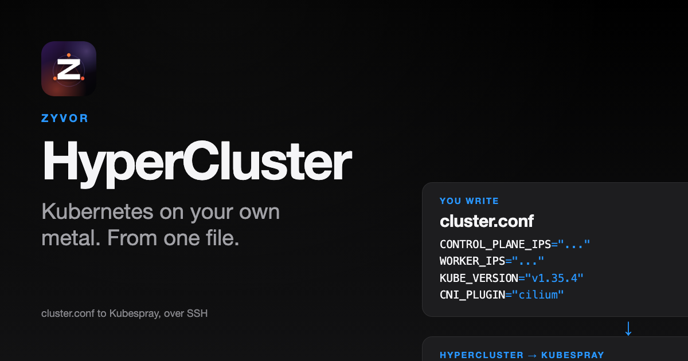

<p align="center">
  
</p>

<h1 align="center">HyperCluster</h1>

<p align="center"><strong>Kubernetes on your own metal. From one file.</strong><br>
Cluster lifecycle for bare metal and private cloud: preflight, deploy, scale, upgrade and kubeconfig over SSH, with Kubespray underneath.</p>

<p align="center">
  <a href="https://zyvor.dev/contact"><strong>Book a demo</strong></a> ·
  <a href="https://github.com/zyvorai/hypercluster/releases/tag/desktop-v0.2.0">Download the 30-day trial</a> ·
  <a href="https://zyvor.dev/hypercluster/pricing">Pricing</a> ·
  <a href="https://zyvorai.github.io/hypercluster/">Website</a> ·
  <a href="docs/customer/README.md">Customer manual</a>
</p>

> **Closed source.** This repository holds the customer documentation for HyperCluster; the source is private. The notarized Desktop app for Apple Silicon is a free 30-day trial on the [releases page](https://github.com/zyvorai/hypercluster/releases/tag/desktop-v0.2.0).

---

## What is HyperCluster?

Kubernetes bring-up with Kubespray is powerful but raw: inventory files, `group_vars`, Ansible configuration and kubeconfig retrieval all need manual wiring. HyperCluster wraps the full Kubespray lifecycle behind a single `cluster.conf`.

**HyperCluster Desktop**, a native macOS app for Apple Silicon, adds a visual Cluster Studio on top of the same engine: a create wizard, a node topology canvas and health views. Everything runs over SSH. There is no cloud provider requirement.

## Highlights

- **One file.** Nodes, SSH access, Kubernetes version, container manager and CNI live in `cluster.conf`. `hypercluster wizard` writes it interactively.
- **Every lifecycle step is a command.** `preflight`, `deploy`, `scale`, `upgrade`, `remove-node`, `fetch-kubeconfig`, `merge-kubeconfig`, `destroy`, `status`, `health`. Add `-n` for a dry run; several commands accept `--json`.
- **Kubespray or k3s.** The Kubespray path is the default; set `K8S_DISTRO="k3s"` for a lightweight lab cluster with Cilium, cert-manager, MetalLB and KubeVirt with CDI.
- **Storage with guardrails.** `storage inventory`, `plan`, `apply` and `teardown` for local-path, lvm-raw and rook-ceph. Disks that hold data are reported ineligible, and `apply` refuses them unless you name each one with `--confirm-destroy`.
- **KubeVirt when you want VMs.** Install the operator and CDI, list VMs and templates, preview a VM create.
- **Discovery.** Find hosts and VMs from libvirt, Proxmox, VMware, an SSH scan or a CSV.
- **Optional AI help.** Ask Zyra in the desktop app is off until you enable it. It calls the provider you configure (an OpenAI-compatible API, Anthropic or a local Ollama); the key is kept in the macOS keychain.

## How it works

```
cluster.conf  ->  hypercluster  ->  Kubespray (Ansible)  ->  your nodes, over SSH
                                    |
                                    |- clones the pinned Kubespray release (KUBESPRAY_VERSION)
                                    |- generates the inventory and group_vars
                                    |- cluster.yml | scale.yml | upgrade | reset
                                    '- fetch-kubeconfig copies admin.conf from the first control-plane node
```

## At a glance

| Area | Detail |
|------|--------|
| **Engine** | Kubespray v2.32.0 (Ansible), pinned by `KUBESPRAY_VERSION` |
| **Kubernetes** | v1.36.4 by default, set with `KUBE_VERSION` |
| **Container manager** | Podman (default), containerd or Docker |
| **CNI** | Cilium (default), Calico, Flannel or kube-ovn |
| **Distribution** | Kubespray (default) or k3s, set with `K8S_DISTRO` |
| **Desktop** | Apple Silicon, macOS 11 or later (tested on macOS 27), 30-day trial |

Values above are the defaults in the `cluster.conf` example shipped with HyperCluster 0.2.0.

## Requirements

| Requirement | Details |
|-------------|---------|
| **Your Mac (Desktop)** | Apple Silicon (arm64), macOS 11 or later |
| **Mac tooling** | bash 5, Python 3.11+, Ansible, `kubectl`, `helm`, `ssh` and `git`, typically installed with Homebrew. The installer's documentation describes a setup script. |
| **Cluster nodes** | Linux nodes reachable over SSH (bare metal, VMs or cloud instances) |
| **SSH key** | Passwordless SSH from your Mac to each node |
| **Internet** | Needed during deploy, to pull Kubernetes images onto the nodes |

## Get it

Download **Hypercluster-0.2.0-arm64.dmg** from the [releases page](https://github.com/zyvorai/hypercluster/releases/tag/desktop-v0.2.0), next to its SHA-256 checksum. It is signed with Zyvor's Developer ID and notarized by Apple.

1. Open the DMG
2. Drag **Hypercluster** into **Applications**
3. Open it, read and accept the Zyvor licence, and the 30-day trial starts on this Mac

Check the download with `shasum -a 256 Hypercluster-0.2.0-arm64.dmg` and compare it with the `.sha256` file on the release.

### First launch — Gatekeeper prompt

On first open, macOS may show *"Hypercluster cannot be opened because Apple cannot check it for malicious software."*

To allow it:
1. Go to **System Settings → Privacy & Security**
2. Scroll down to the Security section
3. Click **"Open Anyway"** next to the Hypercluster message
4. Click **Open** in the confirmation dialog

This only needs to be done once. The release is notarized, so you should normally not see this prompt.

### Trial period

HyperCluster starts a **30-day free trial** when you accept the licence in the app. Reinstalling does not restart it.

**Hypercluster never locks you out.** When the trial ends, or a licence key expires, every feature keeps working; the app only shows that it is unlicensed. A licence key keeps you in good standing, with updates and support. To enter one, click the licence badge at the bottom-right of the window, paste the key (it starts with `ZYV1.`) and choose **Activate**. Keys are checked on your Mac against a public key built into the app; nothing is sent to Zyvor. Prices and plans are on the [pricing page](https://zyvor.dev/hypercluster/pricing); for a key or a quote write to [sales@zyvor.dev](mailto:sales@zyvor.dev).

## Quick start

### Desktop app

1. Open **Hypercluster.app** from Applications or Spotlight (`⌘Space → Hypercluster`)
2. Click **New Cluster** to open the Create Cluster hub, then choose Quick Deploy or Cluster Studio
3. Run preflight: it validates SSH access and your local tools
4. Deploy: runs Kubespray over SSH
5. Fetch the kubeconfig to `~/.kube/`

### CLI

```bash
hypercluster wizard           # write cluster.conf interactively
hypercluster preflight        # verify local tools and SSH to every node
hypercluster deploy           # preflight + init + Kubespray cluster.yml
hypercluster fetch-kubeconfig # copy admin.conf from the first control-plane node
hypercluster health           # nodes, pods, services and VMs
hypercluster scale            # add the worker nodes listed in cluster.conf
hypercluster upgrade          # move to the version in cluster.conf
hypercluster destroy          # tear the cluster down
```

Run `hypercluster -h` for the full command list. Options: `-c <file>` config path, `-n` dry run, `-f` force, `-v` verbose Ansible output.

## Configuration

All settings live in a single `cluster.conf`. An abridged example:

```bash
KUBESPRAY_VERSION="v2.32.0"
K8S_DISTRO="kubespray"              # kubespray | k3s

KUBE_VERSION="v1.36.4"
CONTAINER_MANAGER="podman"          # podman | containerd | docker
CNI_PLUGIN="cilium"                 # cilium | calico | flannel | kube-ovn

# Pod / service CIDRs (must not overlap with the node network)
KUBE_PODS_SUBNET="10.233.64.0/18"
KUBE_SERVICE_ADDRESSES="10.233.0.0/18"

SSH_USER="root"
SSH_KEY="$HOME/.ssh/id_rsa"

# Nodes (space-separated IPv4 addresses)
CONTROL_PLANE_IPS="192.168.1.100"
WORKER_IPS="192.168.1.101 192.168.1.102"
```

The Desktop app generates and edits the cluster configuration visually; manual editing is optional.

## CNI options

| CNI | When to choose |
|-----|---------------|
| **Cilium** | eBPF-native networking; recommended with PacketWolf for policy-heavy KubeVirt workloads |
| **Calico** | Proven BGP-capable option for production bare metal |
| **Flannel** | Simple overlay; good for lab and single-site clusters |
| **kube-ovn** | SDN overlay for multi-tenant or OpenStack-adjacent deployments |

## Suite integration

HyperCluster is the cluster substrate for the full Zyvor product suite:

```
Export → Convert → Inspect → HyperCluster (K8s) → Deploy VMs → Manage → Observe
```

| Product | Role after HyperCluster |
|---------|------------------------|
| [Zeus OS](https://zyvor.dev/zeus-os) | KubeVirt control plane on the cluster |
| [Veyron](https://zyvor.dev/veyron) | KubeVirt VM command center |
| [PacketWolf](https://zyvor.dev/packetwolf) | Kernel-native network intelligence |
| [Forge](https://zyvor.dev/forge) | AI infrastructure on Kubernetes |
| [IronWolf](https://zyvor.dev/ironwolf) | Metal3 bare-metal automation |

## Security

| Property | Detail |
|----------|--------|
| Node access | Over SSH, using Kubespray and Ansible |
| Credentials | SSH key paths are set in `cluster.conf` and stay on your Mac; the optional AI provider key is stored in the macOS keychain |
| kubeconfig | Copied from the first control-plane node over SSH |
| AI assistant | Off by default. When you enable it, requests go to the provider you configure |

## Uninstall

Remove `/Applications/Hypercluster.app`. The distribution folder includes `Uninstall-Hypercluster.command`, which can also remove cluster data; your trial record stays on the Mac so reinstalling does not start a new trial. Your licence key, if any, is kept in `~/.hypercluster/licence.key`.

## Version history

| Version | Date | Changes |
|---------|------|---------|
| **0.2.0** | 2026-11 | First public notarized DMG (trial). Offline licence keys that never disable features, no default web-console password, web console binds to localhost by default, Kubespray v2.32.0, Kubernetes v1.36.4 default |
| **0.1.0** | 2026-06 | Initial release: Desktop app, CLI, Kubespray v2.31.0, Kubernetes v1.35.4 default, four CNIs, k3s path, storage commands |

## Licence and pricing

HyperCluster is closed source under the [Zyvor Production License v1.0](LICENSE): free for non-production use such as evaluation, testing and labs; production use needs a paid licence from Zyvor AI Labs Private Limited. Plans and prices are on the [pricing page](https://zyvor.dev/hypercluster/pricing).

## Contact

- **Book a demo:** [zyvor.dev/contact](https://zyvor.dev/contact)
- **Licence keys and quotes:** [sales@zyvor.dev](mailto:sales@zyvor.dev)
- **Product page:** [zyvor.dev/hypercluster](https://zyvor.dev/hypercluster)
- **Documentation:** [zyvor.dev/docs/hypercluster](https://zyvor.dev/docs/hypercluster)

## Customer manual

**[Customer manual (page-by-page)](docs/customer/README.md)**

---

<sub>© ZYVORAI LABS PRIVATE LIMITED · [zyvor.dev](https://zyvor.dev)</sub>
