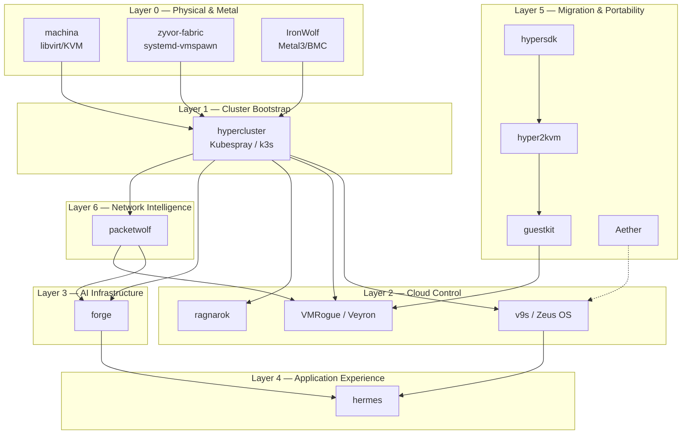
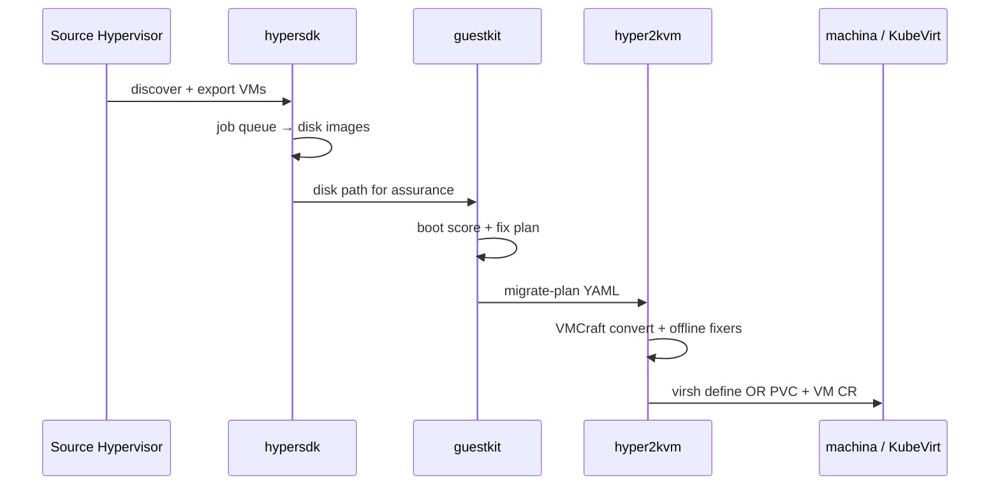

# Zyvor Platform Architecture

**Author:** ssahani · **Audience:** Platform engineers, SREs, architects, and AI coding agents  
**Scope:** End-to-end architecture for the full Zyvor / HyperSDK product portfolio  
**Last updated:** June 2026

---

## Table of Contents

1. [Executive Summary](#1-executive-summary)
2. [Platform Vision & Layer Model](#2-platform-vision--layer-model)
3. [Install Order & Lifecycle](#3-install-order--lifecycle)
4. [Foundation Layer](#4-foundation-layer)
5. [Cloud Control Layer](#5-cloud-control-layer)
6. [Application Layer](#6-application-layer)
7. [Migration & Portability Layer](#7-migration--portability-layer)
8. [Observability & Intelligence Layer](#8-observability--intelligence-layer)
9. [Marketing & Reference](#9-marketing--reference)
10. [Development Umbrella & Utilities](#10-development-umbrella--utilities)
11. [Upstream & Reference Projects](#11-upstream--reference-projects)
12. [Cross-Project Integration Matrix](#12-cross-project-integration-matrix)
13. [Technology & Port Reference](#13-technology--port-reference)
14. [Security Boundaries](#14-security-boundaries)
15. [Deployment Patterns](#15-deployment-patterns)
16. [Per-Project Documentation Index](#16-per-project-documentation-index)

---

## 1. Executive Summary

The **Zyvor platform** is a vertically integrated stack for running enterprise infrastructure — from bare metal through Kubernetes, KubeVirt virtual machines, AI/GPU workloads, and VM migration from legacy hypervisors. Products are deliberately **modular siblings**, not a monolith: each repo owns a domain, exposes stable APIs, and composes with others through kubeconfig handoffs, REST integrations, and shared migration pipelines.

```text
┌─────────────────────────────────────────────────────────────────────────────┐
│                         ZYVOR PLATFORM — AT A GLANCE                        │
├─────────────────────────────────────────────────────────────────────────────┤
│  Day 0        hypercluster          Bare-metal K8s bootstrap (Kubespray/k3s)│
│  Physical     machina · zyvor-fabric · IronWolf   Hypervisor & metal layers │
│  Cloud        v9s · VMRogue · ragnarok            KubeVirt command centers  │
│  AI           forge                               GPU/LLM/FinOps control    │
│  Apps         hermes                              K8s application gateway   │
│  Migration    hypersdk · hyper2kvm · guestkit     Export → inspect → deploy │
│  Portability  Aether                              Multi-runtime workloads   │
│  Network      packetwolf                          Cilium/eBPF intelligence  │
│  Marketing    hypersdk-web                        zyvor.dev product site    │
└─────────────────────────────────────────────────────────────────────────────┘
```

**Design philosophy:**

| Principle | Implementation |
|-----------|----------------|
| **Composable, not monolithic** | hypercluster bootstraps; Forge/Hermes/Zeus install *into* the cluster |
| **Same problem, one owner** | VM migration = hyper2kvm; disk inspect = guestkit; network intel = packetwolf |
| **Kubernetes-native where possible** | Operators, CRDs, Helm charts; systemd for bare-metal daemons |
| **Offline-first migration** | GuestKit + hyper2kvm fix guests *before* boot on KVM |
| **AI as embedded ops** | Forge Zeus, Ragnarok healer, Veyron copilot — not bolt-on chatbots |

Commercial umbrella: [zyvor.dev](https://zyvor.dev) · GitHub org: [ssahani](https://github.com/ssahani)

---

## 2. Platform Vision & Layer Model

The platform follows a **bottom-up dependency stack**. Lower layers provide compute, storage, and networking; upper layers add orchestration, UX, and intelligence.



### Layer Responsibilities

| Layer | Domain | Primary Products | Runtime |
|-------|--------|------------------|---------|
| **0 — Physical** | Hypervisor OS, bare-metal provisioning | machina, zyvor-fabric, IronWolf | Linux host, systemd |
| **1 — Bootstrap** | K8s cluster lifecycle | hypercluster | Ansible, k3s, SSH |
| **2 — Cloud control** | KubeVirt VM operations | v9s, VMRogue, ragnarok | In-cluster + sidecar APIs |
| **3 — AI infra** | GPU, LLM, FinOps, Zeus SRE | forge | K8s operators + microservices |
| **4 — Applications** | App discovery & gateway | hermes | K8s controller + Rust gateway |
| **5 — Migration** | VM export, inspect, deploy | hypersdk, hyper2kvm, guestkit, Aether | Host daemon + CLI |
| **6 — Network intel** | eBPF, Cilium, AutoPolicy | packetwolf | DaemonSet + host CLI |

---

## 3. Install Order & Lifecycle

Reference install path for a greenfield Zyvor deployment. See also [zyvor-platform-stack.md](guides/zyvor-platform-stack.md).

```text
  [Optional] Metal / Hypervisor              [Optional] Migration / Inspect
         │                                            │
         ▼                                            ▼
   machina · zyvor-fabric · IronWolf            guestkit · hyper2kvm
         │                                            │
         └──────────────────┬─────────────────────────┘
                            ▼
                     hypercluster  ◄── Day 0: preflight → deploy → test
                            │
          ┌─────────────────┼─────────────────┐
          ▼                 ▼                 ▼
     packetwolf           forge           v9s (Zeus OS)
   (needs Cilium)      (GPU / AI)      (KubeVirt ops)
          │                 │                 │
          └─────────────────┼─────────────────┘
                            ▼
              ragnarok · VMRogue · Aether · hermes (as needed)
```

### Phase Reference

| Phase | Product | Trigger | Output |
|-------|---------|---------|--------|
| **0a** | machina / zyvor-fabric | Need libvirt or systemd-native VMs on metal | Running hypervisor daemon |
| **0b** | IronWolf | Need Metal3 bare-metal fleet | Provisioned BareMetalHosts |
| **0c** | guestkit + hyper2kvm | Migrating from VMware/Azure/Hyper-V | Converted QCOW2 + fix plans |
| **1** | hypercluster | Always first for K8s | `KUBECONFIG`, KubeVirt/CDI optional |
| **2** | packetwolf | Cilium-enabled cluster | Network intelligence plane |
| **3a** | forge | GPU/AI workloads | 60+ CRDs, Zeus, operators |
| **3b** | v9s / VMRogue / ragnarok | KubeVirt VM UX | VM command centers |
| **4** | hermes | Application layer UX | `/a/{ns}/{app}` gateway |
| **5** | Aether | Multi-runtime portability | Unified deploy/migrate |

### Forge Handoff (Day 2)

After hypercluster deploy:

```bash
./hypercluster -c cluster.conf forge-handoff --json > handoff.json
# From forge checkout:
./scripts/lib/hypercluster-handoff.sh --handoff handoff.json
```

---

## 4. Foundation Layer

### 4.1 hypercluster

**Repo:** [ssahani/hypercluster](https://github.com/ssahani/hypercluster) · **Role:** Day 0 Kubernetes bootstrap

| Attribute | Detail |
|-----------|--------|
| **Stack** | Bash orchestrator, Ansible (Kubespray), k3s shell libs, Electron desktop |
| **Entry point** | `hypercluster` CLI script |
| **Key paths** | `hypercluster`, `lib/`, `config/cluster.conf.example`, `desktop/` |
| **Commands** | `init`, `preflight`, `deploy`, `scale`, `upgrade`, `destroy`, `kubeconfig`, `test`, `health`, `forge-handoff` |

**Architecture:**

```text
cluster.conf → hypercluster CLI → SSH → Ansible/k3s → nodes
                                 → fetch-kubeconfig → ~/.kube/config
                                 → optional: KubeVirt + CDI + Cilium + MetalLB
```

**k3s path bundles:** Cilium, cert-manager, MetalLB, KubeVirt, CDI. **Kubespray path:** Full HA control plane for production.

**Integrations:** Bootstraps clusters consumed by Forge, Hermes, Zeus OS, Veyron, PacketWolf, Ragnarok.

---

### 4.2 machina

**Repo:** [ssahani/machina](https://github.com/ssahani/machina) · **Role:** Enterprise libvirt/KVM hypervisor management

| Attribute | Detail |
|-----------|--------|
| **Stack** | Rust workspace (12 crates), React 19 web UI, ratatui TUI |
| **Daemon** | `machina-daemon` — HTTPS `:5092` |
| **Entry points** | `daemon/src/main.rs`, `machinactl`, `web/`, `tui/` |
| **Hypervisor** | libvirt → QEMU/KVM |

**Core components:**

| Component | Path | Responsibility |
|-----------|------|----------------|
| REST + WebSocket API | `daemon/` | VM lifecycle, console proxies, RBAC |
| Web dashboard | `web/` | 40+ pages, noVNC/xterm.js |
| TUI client | `tui/` | Terminal VM management |
| Fleet controller | `controller/` | Multi-host orchestration |
| Per-host agent | `agent/` | libvirt RPC on worker nodes |
| Core libvirt layer | `core/` | Bindings, validation, types |

**Data flow:**

```text
Web/TUI/API → machina-daemon → libvirt API → QEMU/KVM
WebSocket   → VNC/SPICE/serial/SSH proxy → guest console
Prometheus  ← /api/v1/prometheus
```

**Integrations:** Physical layer under Zeus OS; KubeVirt migration path; OpenStack Nova/Glance; PacketWolf observability; hyper2kvm import target.

**Active dev branch:** `machina-hw-pr` — KubeVirt hardware drawers, ConsoleHub cinema mode, PCI/USB passthrough API.

---

### 4.3 zyvor-fabric

**Repo:** [ssahani/zyvor-fabric](https://github.com/ssahani/zyvor-fabric) · **Role:** systemd-native private cloud control plane

| Attribute | Detail |
|-----------|--------|
| **Stack** | Rust (40 crates), React web UI, K8s operator, Terraform provider |
| **Daemon** | `vmspawnd` — HTTPS `:8443`, 480+ REST endpoints |
| **Runtime** | systemd-vmspawn, systemd-machined, KVM |
| **CLI** | `vmctl`, `vmctl-tui` |

**Architecture:**

```text
vmctl / TUI / Web / TF / Operator → vmspawnd → vmspawn-driver → systemd-vmspawn → KVM
                                  → D-Bus → machined → scope management
```

**Key paths:** `backend/vmspawnd/`, `backend/vmspawn-driver/`, `backend/crates/machinectl-driver/`, `backend/networking/`, `backend/storage/`, `backend/gpu-passthrough/`, `backend/ha/`, `integrations/machina/`

**Positioning:** Alternative to machina for operators who prefer systemd-native VM management over libvirt. Integrates with machina via `integrations/machina/`.

---

### 4.4 IronWolf

**Repo:** [ssahani/IronWolf](https://github.com/ssahani/IronWolf) · **Role:** Metal3 bare-metal automation extension

| Attribute | Detail |
|-----------|--------|
| **Stack** | Go controller-runtime, React dashboard, 24 CRDs (`bmo.metal3.io`) |
| **Dashboard** | `:8888` |
| **Extends** | Metal3 BareMetal Operator |

**Core CRDs & controllers:**

| Resource | Purpose |
|----------|---------|
| ClusterClaim | Hardware allocation (binpack/spread/topology) |
| FirmwareProfile | Fleet firmware lifecycle |
| HardwareBackup | BMC configuration backup |
| RemediationStrategy | Progressive auto-escalation |
| BMC Reconciler | IPMI/Redfish/iLO/iDRAC |

**Data flow:**

```text
ClusterClaim → scheduler → BareMetalHost → Ironic provision → K8s node
FirmwareProfile → BMC Reconciler → firmware update → status CR
Dashboard ← WebSocket ← controller events
```

**Integrations:** Feeds bare metal into hypercluster and Aether Metal3 runtime.

---

## 5. Cloud Control Layer

Three products address KubeVirt VM management with different emphases. They overlap in domain but target different personas and feature depth.

| Product | GitHub | Emphasis | Default Port |
|---------|--------|----------|--------------|
| **v9s (Zeus OS)** | zeus-os | Visual OS for K8s/VMs; 48+ TUI views; enterprise auth | `:5050` |
| **VMRogue (Veyron)** | Veyron | GitOps CRDs, templates, Mission Control | `:8080` |
| **ragnarok** | ragnarok | AI-powered VM ops, NL provisioning, cost optimizer | Helm Ingress |

---

### 5.1 v9s (Zeus OS)

**Repo:** [ssahani/zeus-os](https://github.com/ssahani/zeus-os) · Local folder: `v9s`

| Attribute | Detail |
|-----------|--------|
| **Stack** | Rust workspace (`core`, `tui`, `web`, `cli`), kube-rs, React UI |
| **Surfaces** | Web dashboard, 48+ TUI views, CLI |
| **Auth** | OIDC, LDAP, SAML, tenants, API tokens, audit |

**Key paths:** `core/` (KubeVirt client), `tui/`, `ui/`, `cli/`, `chart/`, `integrations/`, `runbooks/`

**Capabilities:** VM lifecycle, hot-plug, live migration, VNC/serial/SSH consoles with WebSocket metrics, cost visibility, topology/RCA hooks, Velero integration.

**Data flow:**

```text
zeus-os TUI/web → kube-rs → KubeVirt API → VirtualMachine/VMI CRs
WebSocket watch → live state → dashboards/consoles
OIDC → session → scoped API tokens
```

**Positioning:** Primary cloud-layer command center; hosts Hermes application layer.

---

### 5.2 VMRogue (Veyron)

**Repo:** [ssahani/Veyron](https://github.com/ssahani/Veyron) · Local folder: `VMRogue`

| Attribute | Detail |
|-----------|--------|
| **Stack** | Rust core (`veyron` binary), Go operator, React Mission Control |
| **CRDs** | VeyronVM, VeyronPolicy (CEL deny rules) |
| **Templates** | 44 OS templates, 8 resource profiles |

**Key paths:**

| Path | Purpose |
|------|---------|
| `src/api/server.rs` | REST API (49+ route groups) |
| `src/kube/guestkit_client.rs` | GuestKit pre-flight integration |
| `src/templates/` | LAMP, K8s, 3-tier, CI/CD blueprints |
| `src/gitops/` | GitOps export/sync |
| `src/migration/` | Live/offline migration strategies |
| `operator/main.go` | VeyronVM CRD reconciler |
| `terraform-provider-vmrogue/` | Terraform provider |

**Capabilities:** Template/blueprint engine, declarative VeyronVM CRs, direct K8s VNC (no virtctl timeout), GuestKit assurance, PacketWolf network context, copilot handlers.

---

### 5.3 ragnarok

**Repo:** [ssahani/ragnarok](https://github.com/ssahani/ragnarok)

| Attribute | Detail |
|-----------|--------|
| **Stack** | Rust backend (Axum, kube-rs, SQLx/PostgreSQL), React frontend, KubeVirt operator |
| **AI features** | NL provisioning, AI healer, cost optimizer |
| **Deploy** | Helm, Terraform, Ansible, Playwright E2E |

**Key paths:** `backend/`, `frontend/`, `operator/`, `charts/ragnarok/`, `docs/AI_NL.md`

**Integrations:** Optional composite with Aether via `RAGNAROK_URL` for attestation.

---

## 6. Application Layer

### 6.1 hermes

**Repo:** [ssahani/hermes](https://github.com/ssahani/hermes) · **Role:** Application Operating Layer for Kubernetes

| Attribute | Detail |
|-----------|--------|
| **Stack** | Go controller, Rust server (Axum), React UI, SQLite catalog |
| **Gateway** | `/a/{namespace}/{slug}/*` reverse proxy + WebSocket |
| **Default port** | `:31847` |

**Architecture:**

```text
K8s Services → Go Controller → SQLite catalog → Rust Server → React UI
User click   → Gateway /a/ns/app → ClusterIP Service (HTTP/WebSocket proxy)
```

**Key paths:** `cmd/hermes-controller/`, `crates/hermes-server/`, `crates/hermes-gateway/`, `ui/`, `charts/hermes/`

**Recognition engine:** Auto-discovers Grafana, Argo CD, Harbor, Zeus/v9s, Forge via labels/annotations. Application memory: favorites, recents, spotlight search.

**Positioning:** Launchpad-style UX on top of Zeus OS clusters.

---

## 7. Migration & Portability Layer

### 7.1 End-to-End Migration Pipeline



---

### 7.2 hypersdk

**Repo:** [ssahani/hypersdk-](https://github.com/ssahani/hypersdk-) · Public: [hypersdk/hypersdk](https://github.com/hypersdk/hypersdk)

| Attribute | Detail |
|-----------|--------|
| **Stack** | Go 1.25, chi router, bbolt/SQLite, embedded React dashboard |
| **Daemon** | `hypervisord` — `:5080` |
| **CLI binaries** | `hyperctl`, `hyperexport`, + 6 more |
| **Providers** | vSphere, Nutanix, AWS, Azure, GCP, Hyper-V, + others |

**Key paths:** `cmd/hypervisord/`, `daemon/api/server.go` (238 routes), `daemon/jobs/manager.go`, `providers/`, `web/dashboard-react/`, `openapi.yaml`

**Architecture:** Hexagonal provider adapters → job scheduler → export pipeline (discover → export → convert → manifest) → WebSocket progress to dashboard.

---

### 7.3 hyper2kvm

**Repo:** [ssahani/hyper2kvm-](https://github.com/ssahani/hyper2kvm-) · Public: [hypersdk/hyper2kvm](https://github.com/hypersdk/hyper2kvm)

| Attribute | Detail |
|-----------|--------|
| **Stack** | Python VMCraft engine, Go h2kweb API, React dashboard, K8s operator |
| **Web API** | `h2kweb` — HTTPS `:5070` (110+ endpoints) |
| **CLI** | `h2kvmctl`, `h2k`, zkvm TUI (Go/Bubble Tea) |

**Key paths:** `hyper2kvm/vmcraft/`, `hyper2kvm/pipeline/`, `hyper2kvm/fixers/`, `hyper2kvm/providers/`, `web/h2kweb/`, `web/dashboard/`, `operator/`

**VMCraft engine:** Pure-Python disk/VM manipulation — 5–7× faster than shell pipelines. **Offline fix engine:** 35+ OS versions, Windows VirtIO injection, GRUB/fstab/initramfs fixes.

**Capabilities:** Full VM lifecycle, VNC console, multi-cluster kubeconfig, libvirt→KubeVirt live migration.

---

### 7.4 guestkit

**Repo:** [hypersdk/guestkit](https://github.com/hypersdk/guestkit) · Local: `guestkit`

| Attribute | Detail |
|-----------|--------|
| **Stack** | Pure Rust (no libguestfs), clap CLI, ratatui TUI (`guestctl`) |
| **Bindings** | PyO3 → `hypersdk-guestkit` on PyPI |
| **Disk formats** | QCOW2, VMDK, RAW |

**Key paths:** `src/disk/`, `src/core/`, `crates/guestkit-agent-protocol/`, `crates/zyvor-guest-agent/`, `k8s/`

**Commands:**

| Command | Output |
|---------|--------|
| `doctor` | Boot probability + blockers |
| `migrate-plan` | Hypervisor-aware fix YAML |
| `fleet analyze` | Multi-VM assurance report |

**Disk intelligence:** MBR/GPT, ext4/NTFS/XFS detection, Windows registry parsing — all without booting the guest.

---

### 7.5 Aether

**Repo:** [ssahani/Aether](https://github.com/ssahani/Aether) · **Role:** Universal runtime portability control plane

| Attribute | Detail |
|-----------|--------|
| **Stack** | Rust (~37K LOC), React 18 web UI, Helm, deb/rpm |
| **Runtimes** | Podman, Kubernetes, KubeVirt, Metal3 |
| **Migration** | 16 runtime-pair combinations |
| **Default port** | `:8080` |

**Key paths:** `src/adapters/`, `src/migration/`, `src/intelligence/`, `src/drift/`, `src/api/`, `web/`, `helm/`

**Core abstractions:**

| Component | Responsibility |
|-----------|----------------|
| Unified Workload Spec | Single YAML validated across four runtimes |
| Intent Engine | Scores cost, latency, reliability → runtime selection |
| Migration Engine | Blue-green, rolling, immediate with rollback |
| Policy Gate | OPA-style checks, RBAC API |
| Drift Detector | Live reconciliation loop |

**Analogy:** Terraform for *where* workloads run — not just *what* they are.

---

## 8. Observability & Intelligence Layer

### 8.1 forge

**Repo:** [ssahani/forge](https://github.com/ssahani/forge) · **Role:** Kubernetes-native AI infrastructure control plane

| Attribute | Detail |
|-----------|--------|
| **Stack** | Go operators, Python microservices (FastAPI), Rust CLI, React web-ui (94 pages), 24 eBPF programs |
| **CRDs** | 60+ custom resources |
| **API Gateway** | `:24631` |

**Service map:**

| Service | Port | Role |
|---------|------|------|
| API Gateway | 24631 | Auth, tenancy, aggregation |
| Intelligence Engine | 8090 | Closed-loop optimizers |
| Zeus | 8091 | AI ops engineer, multi-LLM agents |
| Topology Engine | 8092 | Service topology |
| Incident Engine | 8093 | Incident correlation |
| Model Router | 8094 | LLM routing |
| Embedding Service | 8095 | Vector embeddings |

**Operators:** GPU, AI, Quota, Network Intelligence, Virtualization.

**Architecture layers:**

```text
Clients (UI/CLI/SDK) → API Gateway → Zeus | Intelligence | Operators
Intelligence tick → optimizers → remediation plan → ActionBroker → K8s mutations
GPU nodes → node-agent → DCGM → Prometheus → dashboards
```

**Design principles:** Kubernetes-native first, closed-loop intelligence, Zeus embedded (not bolted on), defense in depth, graceful degradation, air-gap readiness.

Full detail: [forge/docs/ARCHITECTURE.md](../../forge/docs/ARCHITECTURE.md)

---

### 8.2 packetwolf

**Repo:** [ssahani/packetwolf](https://github.com/ssahani/packetwolf) · **Role:** Kernel-native network intelligence for Kubernetes

| Attribute | Detail |
|-----------|--------|
| **Stack** | Rust (~71K LOC), eBPF programs, Axum web-api (130+ routes), 18-tab TUI |
| **CLI** | `netpred` |
| **Requires** | Cilium on cluster |
| **Default port** | `:8443` |

**Key paths:** `src/modules/` (15 intelligence modules), `src/ebpf/`, `src/policies/`, `web-api/`, `netpred-ebpf/`, `chart/`

**Capabilities:**

| Feature | Description |
|---------|-------------|
| God Mode explain | Cross-layer root cause: `netpred explain <service>` |
| AutoPolicy | Traffic learning → Cilium NetworkPolicy suggestions |
| Autonomous Healer | Network remediation |
| Process attribution | Process-to-socket mapping |

**Integrations:** Intelligence plane for Forge; Veyron PacketWolf handler; requires Cilium.

---

## 9. Marketing & Reference

### 9.1 hypersdk-web

**Repo:** [ssahani/hypersdk-web](https://github.com/ssahani/hypersdk-web) · **Role:** Enterprise marketing website (not a runtime product)

| Attribute | Detail |
|-----------|--------|
| **Stack** | Docusaurus 3, React 19, Go contact-mailer |
| **Published** | [zyvor.dev](https://zyvor.dev) |
| **Content** | 52 pages, 16 blog posts, 30+ PDF presentations |

**Architecture:**

```text
Static Docusaurus build → nginx :443 → contact form → Go mailer
```

Links to live products: hypersdk (`:5080`), hyper2kvm (`:5070`).

---

## 10. Development Umbrella & Utilities

### 10.1 tt (meta-workspace)

**Path:** `/Users/ssahani/tt/tt/` · **Role:** Local cross-project development umbrella (not a deployable product)

| Subproject | Purpose |
|------------|---------|
| `hypersdk/` | Go VM export daemon (mirror of hypersdk-) |
| `hyper2kvm/` | Python migration toolkit (mirror of hyper2kvm-) |
| `netctl/` | Rust CLI for systemd-networkd declarative config |
| `netevd/` | Rust network event daemon (netlink, hooks, REST, Prometheus) |
| `cloud-netconfig/` | Multi-cloud instance network config (AWS/Azure/GCP metadata) |
| `hypersdk-org-profile/` | GitHub org profile assets |

Supporting infrastructure for machina, zyvor-fabric, and migration VMs.

---

## 11. Upstream & Reference Projects

These projects live in the workspace for integration reference but are **not Zyvor products**:

| Project | Upstream | Role in workspace |
|---------|----------|-------------------|
| **cockpit** | cockpit-project/cockpit | Linux server admin UI reference |
| **cockpit-machines** | cockpit-project/cockpit-machines | libvirt VM module reference |
| **machina-hw-pr** | ssahani/machina (dev branch) | Active KubeVirt hardware integration PR |

---

## 12. Cross-Project Integration Matrix

| From | To | Integration Mechanism |
|------|----|-----------------------|
| hypercluster | Forge, Hermes, Zeus, Veyron | kubeconfig handoff, `forge-handoff --json` |
| machina | v9s | Physical hypervisor → cloud VM layer |
| machina | hyper2kvm | VM import/migration to libvirt |
| hypersdk | hyper2kvm | Export → convert/deploy pipeline |
| guestkit | hyper2kvm, Veyron | Pre-flight boot scoring + fix plans |
| guestkit | Veyron | `src/kube/guestkit_client.rs` |
| Aether | All runtimes | Unified deploy/migrate across Podman/K8s/KubeVirt/Metal3 |
| packetwolf | forge | Intelligence plane network module |
| packetwolf | Veyron | `src/api/handlers/packetwolf.rs` |
| hermes | v9s | Application layer on Zeus OS clusters |
| IronWolf | hypercluster, Aether | Bare-metal provisioning → K8s/Metal3 |
| forge | packetwolf, Zeus | AI ops + network intelligence |
| zyvor-fabric | machina | Cross-product via `integrations/machina/` |
| Aether | ragnarok | Optional attestation via `RAGNAROK_URL` |

---

## 13. Technology & Port Reference

### Language Distribution

| Language | Products |
|----------|----------|
| **Rust** | Aether, machina, zyvor-fabric, v9s, VMRogue, ragnarok, packetwolf, guestkit, forge CLI, hermes server, netctl, netevd |
| **Go** | forge operators, hypersdk, IronWolf, Veyron operator, hermes controller, hyper2kvm h2kweb |
| **Python** | hyper2kvm VMCraft, forge services |
| **TypeScript/React** | All web UIs, hypersdk-web |
| **Bash/Ansible** | hypercluster |
| **C** | cockpit (upstream) |

### Default Service Ports

| Product | Port | Protocol |
|---------|------|----------|
| v9s (Zeus OS) web | 5050 | HTTP |
| hyper2kvm h2kweb | 5070 | HTTPS |
| hypersdk dashboard | 5080 | HTTPS |
| machina daemon | 5092 | HTTPS |
| Veyron (VMRogue) | 8080 | HTTPS |
| Aether API | 8080 | HTTP |
| Forge API Gateway | 24631 | HTTP |
| Forge Zeus | 8091 | HTTP |
| Forge Intelligence | 8090 | HTTP |
| Hermes | 31847 | HTTP |
| zyvor-fabric / packetwolf web | 8443 | HTTPS |
| IronWolf dashboard | 8888 | HTTP |

### CRD Inventory (Summary)

| Product | CRD Count | API Group |
|---------|-----------|-----------|
| forge | 60+ | forge.* |
| IronWolf | 24 | bmo.metal3.io |
| Veyron | 2+ | VeyronVM, VeyronPolicy |
| packetwolf | 5 | netpred.* |
| ragnarok | operator-managed | KubeVirt extensions |

---

## 14. Security Boundaries

```text
┌─────────────────────────────────────────────────────────────────┐
│  Edge / Ingress                                                 │
│  TLS termination · OIDC/SAML/LDAP · API tokens · rate limits    │
├─────────────────────────────────────────────────────────────────┤
│  Control Plane APIs (Forge GW, Zeus, Veyron, machina-daemon)    │
│  JWT/API-key auth · RBAC · tenant namespaces · audit logs       │
├─────────────────────────────────────────────────────────────────┤
│  Kubernetes API Server                                          │
│  RBAC · NetworkPolicies · PodSecurity · CRD admission           │
├─────────────────────────────────────────────────────────────────┤
│  Node / Host                                                    │
│  PAM (machina) · systemd hardening · eBPF (packetwolf/forge)    │
├─────────────────────────────────────────────────────────────────┤
│  BMC / Out-of-band                                              │
│  IronWolf BMC reconciler · IPMI/Redfish credentials vault       │
└─────────────────────────────────────────────────────────────────┘
```

**Key patterns:**

- **Forge:** API governance middleware, per-tenant rate limits, FabricAutoPolicy gates, optional Vault CSI
- **machina / zyvor-fabric:** PAM auth, RBAC, encryption at rest, audit trails
- **Aether:** OPA-style policy gate, RBAC API (`RbacStore`)
- **Veyron:** VeyronPolicy CEL deny rules
- **Migration tools:** Credential store in hypervisord (bbolt); offline disk analysis (no network exposure)

---

## 15. Deployment Patterns

| Pattern | Products | Install Method |
|---------|----------|----------------|
| **Single binary + systemd** | Aether, machina, guestkit, hypersdk, zyvor-fabric, netevd, netctl | `cargo install` / `make install` + systemd unit |
| **K8s Helm operator** | Forge, Hermes, IronWolf, Veyron, Ragnarok, PacketWolf, hyper2kvm | `helm upgrade --install` |
| **Bash/Ansible bootstrap** | hypercluster | `./hypercluster deploy` from operator laptop |
| **Python pip + Go daemon** | hyper2kvm | `pip install hyper2kvm` + `h2kweb` systemd |
| **Static marketing site** | hypersdk-web | `npm run build` → nginx |
| **Upstream distro packages** | cockpit, cockpit-machines | dnf/apt packages |
| **Meta-workspace** | tt | Per-subproject build; no unified deploy |

### Recommended Production Stack

```text
IronWolf (metal) → hypercluster (Kubespray HA) → Cilium + KubeVirt/CDI
  → packetwolf → forge (GPU) → v9s → hermes
  → hypersdk + guestkit + hyper2kvm (migration lane)
  → Aether (portability overlay, optional)
```

---

## 16. Per-Project Documentation Index

| Project | Canonical Architecture Doc |
|---------|---------------------------|
| Aether | `Aether/docs/architecture/ARCHITECTURE.md` |
| forge | `forge/docs/ARCHITECTURE.md` |
| guestkit | `guestkit/README.md` |
| hermes | `hermes/docs/architecture.md` |
| hyper2kvm | `hyper2kvm-/docs/reference/architecture.md` |
| hypercluster | `hypercluster/docs/guides/zyvor-platform-stack.md` |
| hypersdk | `hypersdk-/docs/architecture/ARCHITECTURE.md` |
| IronWolf | `IronWolf/docs/architecture.md` |
| machina | `machina/README.md`, `machina/docs/` |
| packetwolf | `packetwolf/docs/architecture/ARCHITECTURE.md` |
| ragnarok | `ragnarok/docs/ARCHITECTURE.md` |
| v9s | `v9s/docs/ZEUS_OS.md` |
| VMRogue | `VMRogue/README.md` |
| zyvor-fabric | `zyvor-fabric/ARCHITECTURE.md` |
| **Platform (this doc)** | `hypercluster/docs/PLATFORM_ARCHITECTURE.md` |

Legacy deep dives: `docs/FULL_README_LEGACY.md` in Aether, hermes, hyper2kvm-, hypercluster, hypersdk-, IronWolf, machina, packetwolf, ragnarok, v9s, VMRogue.

---

## Appendix A — Domain Ownership (Non-Goals)

Products must **not** re-implement sibling domains. Reference: [hypercluster agent training § Scope](agents/training.md#2-scope--non-goals).

| Domain | Owner | Do NOT build in |
|--------|-------|-----------------|
| vLLM / Triton / KServe | forge | hypercluster |
| VM vCenter-style cockpit | v9s, ragnarok, VMRogue | hypercluster |
| Bare-metal hypervisor UI | machina, zyvor-fabric | hypercluster |
| VMware → KVM migration | hyper2kvm + guestkit | hypercluster |
| Network auto-policy / eBPF | packetwolf | hypercluster |
| Full observability stack | forge, VMRogue | hypercluster |
| GitOps / Tekton | forge/gitops | hypercluster |
| Multi-runtime portability | Aether | single-cluster products |

---

## Appendix B — GitHub Repository Map

| Local Folder | GitHub Repository | Visibility |
|--------------|-------------------|------------|
| Aether | ssahani/Aether | Private |
| forge | ssahani/forge | Private |
| guestkit | hypersdk/guestkit | Public |
| hermes | ssahani/hermes | Private |
| hyper2kvm- | ssahani/hyper2kvm- | Private |
| hypercluster | ssahani/hypercluster | Private |
| hypersdk- | ssahani/hypersdk- | Private |
| hypersdk-web | ssahani/hypersdk-web | Private |
| IronWolf | ssahani/IronWolf | Private |
| machina | ssahani/machina | Private |
| packetwolf | ssahani/packetwolf | Private |
| ragnarok | ssahani/ragnarok | Private |
| v9s | ssahani/zeus-os | Private |
| VMRogue | ssahani/Veyron | Private |
| zyvor-fabric | ssahani/zyvor-fabric | Private |

---

_Document version: 2026-06-17 · Maintainer: ssahani · Platform codename: Zyvor_
