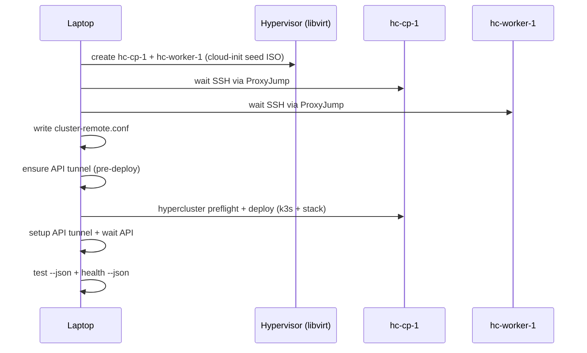

# Remote libvirt deploy — user story

End-to-end k3s platform deployment on two libvirt VMs (1 control plane + 1 worker) hosted on a remote hypervisor, managed entirely from the laptop via `scripts/deploy-remote.sh` and `hypercluster`.

## User story

**As a** platform engineer with a remote AlmaLinux/RHEL libvirt host  
**I want to** run one command from my laptop to create VMs, install k3s, deploy the full virtualization stack, and pass smoke tests  
**So that** I get a production-like KubeVirt lab without manual SSH fixes, tunnel wiring, or VM reboots.

### Persona

- Hypervisor: `sus@175.110.114.93` (libvirt NAT, `default` network)
- Laptop: macOS with Homebrew bash 4+, `hypercluster`, `kubectl`, `helm`
- Guests: Ubuntu 22.04 cloud images (`hc-cp-1`, `hc-worker-1`)

### Acceptance criteria

| # | Criterion | Verified by |
|---|-----------|-------------|
| 1 | Two libvirt VMs created with SSH key injection and DHCP IPs | `cluster-remote.conf` written |
| 2 | k3s server + worker joined; kube-proxy disabled for Cilium | `kubectl get nodes` |
| 3 | Platform stack installed in order: Cilium → cert-manager → MetalLB → KubeVirt/CDI → metrics-server | `hypercluster deploy` |
| 4 | Laptop reaches API via SSH tunnel (`127.0.0.1:16443`) | `K3S_API_LOCAL_PORT` in config |
| 5 | Platform smoke tests pass | `hypercluster test --json` → **11/11** |
| 6 | Fleet health is healthy | `hypercluster health --json` → `"state":"healthy"` |
| 7 | No manual steps during deploy (no ad-hoc VM reboots, tunnel fixes, or network heals) | `./scripts/deploy-remote.sh` exit 0 |

### Out of scope

- Kubespray / multi-node bare-metal
- Desktop UI lifecycle (Desktop still spawns `hypercluster` only)
- Longhorn or GPU operator on default remote profile

---

## Quick start

```bash
# Full clean deploy (~30–60 min for platform stack)
./scripts/deploy-remote.sh sus 175.110.114.93 --clean
./scripts/deploy-remote.sh sus 175.110.114.93

# Verify existing cluster
./scripts/deploy-remote.sh --verify

# Resume after VMs exist (uses cluster-remote.conf)
./scripts/deploy-remote.sh --deploy-only

# VMs + config only (no k3s deploy)
./scripts/deploy-remote.sh sus 175.110.114.93 --vms-only
```

Makefile aliases:

```bash
make deploy-remote-vms HYPERVISOR=sus@175.110.114.93
make verify-remote-vms
```

Kubeconfig default: `~/.kube/hc-remote.yaml`

---

## Deploy flow



### Deploy order (inside `hypercluster deploy`)

1. Preflight (SSH, MetalLB pool, `/dev/kvm`)
2. k3s install (server + workers, `--disable-kube-proxy`, `--disable metrics-server`)
3. Fetch kubeconfig (laptop + remote user)
4. Platform stack: Cilium → cert-manager → MetalLB → snapshot-controller → metrics-server → KubeVirt → CDI → CNAO → SSP
5. Remote CLI tools + kubeconfig merge

---

## Configuration defaults

Generated in `cluster-remote.conf` (gitignored):

| Variable | Default | Notes |
|----------|---------|-------|
| `VM_CP_MEM` | **8192** MiB | KubeVirt runs 2× `virt-api` on control-plane |
| `VM_WORKER_MEM` | **4096** MiB | Worker workloads |
| `VM_CPUS` | 2 | Both VMs |
| `VM_DISK` | 20G | qcow2 backing cloud image |
| `METALLB_IP_POOL` | auto-detect | libvirt `default` subnet high range |
| `K3S_API_LOCAL_PORT` | 16443 | SSH tunnel to CP:6443 |
| `SSH_PROXY_JUMP` | hypervisor | `ProxyJump` for guest SSH |
| `KUBEVIRT_API_REPLICAS` | 1 | Optional scale-down for small labs |

Override at deploy time:

```bash
VM_CP_MEM=8192 VM_WORKER_MEM=4096 METALLB_IP_POOL=192.168.122.240-192.168.122.250 \
  ./scripts/deploy-remote.sh sus@175.110.114.93
```

---

## Problems solved (June 2026 hardening)

### 1. Log stdout pollution

**Symptom:** `cluster-remote.conf` contained log lines instead of IPs; `cp_ip="$(wait_guest_ssh …)"` captured `[07:42:36] ➜ …`.

**Fix:** `log::info`, `log::ok`, `log::section` → stderr (`lib/log.sh`).

### 2. SSH / ProxyJump

**Symptom:** Preflight and kubeconfig fetch ignored `SSH_PROXY_JUMP`; circular nameref in `ssh::append_extra_opts`.

**Fix:** Unified `ssh::node_opts` in preflight, kubeconfig, k3s (`lib/preflight.sh`, `lib/kubeconfig.sh`, `lib/ssh.sh`, `lib/k3s.sh`).

### 3. Kubeconfig fetch timeout

**Symptom:** Intermittent `Operation timed out` right after k3s install.

**Fix:** 6× SSH retry with 10s backoff; capture kubeconfig to variable before write (`lib/kubeconfig.sh`).

### 4. API tunnel timing

**Symptom:** Kubeconfig patched to `127.0.0.1:16443` before tunnel existed; stale tunnel on port 16443.

**Fix:** `ensure_api_tunnel` before deploy; `setup_api_tunnel` after deploy; kill listeners via `lsof`; `ControlMaster=no` on tunnel SSH (`scripts/deploy-remote.sh`, `scripts/lib/deploy-remote-libvirt.sh`).

### 5. AlmaLinux hypervisor seed ISO

**Symptom:** No `cloud-localds` on AlmaLinux 9; `--cloud-init` virt-install path failed SSH key injection.

**Fix:** Install `genisoimage` / `cloud-image-utils`; always attach seed CDROM; `make_seed_iso()` helper (`scripts/lib/deploy-remote-libvirt.sh`).

### 6. Guest SSH wait

**Symptom:** Aggressive VM reboot during cloud-init; stale DHCP IPs.

**Fix:** 90s cloud-init wait; refresh IP from libvirt every 6 tries; return IP on stdout; no reboot loop (`scripts/lib/deploy-remote-libvirt.sh`).

### 7. metrics-server conflict

**Symptom:** k3s bundles metrics-server; platform apply failed with duplicate port name `https`.

**Fix:** `--disable metrics-server` in `K3S_EXEC_ARGS`; delete deployment before apply (`scripts/deploy-remote.sh`, `lib/platform-stack.sh`).

### 8. Stuck Helm releases

**Symptom:** `another operation (install/upgrade/rollback) is in progress` after interrupted deploy.

**Fix:** `platform::_helm_unstick`; skip helm reconcile when workloads already ready (`lib/platform-stack.sh`).

### 9. SSP validating webhook timeout

**Symptom:** API server on CP host cannot reach webhook pod on worker pod network (Cilium native routing).

**Fix:** Pin `ssp-operator` to control-plane node; webhook TLS bootstrap + caBundle patch; 10 retries; non-fatal if SSP optional (`lib/platform-stack.sh`).

### 10. KubeVirt virt-api pending (health degraded)

**Symptom:** Second `virt-api` replica pending — CP out of memory (3 GiB default).

**Fix:** Default `VM_CP_MEM=8192`; optional `KUBEVIRT_API_REPLICAS=1` (`scripts/deploy-remote.sh`, `lib/platform-stack.sh`).

---

## Files changed

| File | Purpose |
|------|---------|
| `scripts/deploy-remote.sh` | Orchestrator: `--deploy-only`, tunnel order, VM sizing, k3s flags |
| `scripts/lib/deploy-remote-libvirt.sh` | VM create, SSH wait, API tunnel helpers |
| `lib/log.sh` | stderr logging |
| `lib/ssh.sh` | ProxyJump / extra opts fix |
| `lib/preflight.sh` | `ssh::node_opts` for guest checks |
| `lib/kubeconfig.sh` | SSH retry + ProxyJump |
| `lib/k3s.sh` | Longer API wait when tunnel port set |
| `lib/platform-stack.sh` | Helm unstick, metrics-server, SSP CP pin, Cilium retry |

---

## Troubleshooting

| Issue | Check | Action |
|-------|-------|--------|
| `bind [127.0.0.1]:16443: Address already in use` | `lsof -i :16443` | Re-run deploy; tunnel cleanup is automatic |
| SSH to guest fails | `ssh -J sus@host ubuntu@<guest-ip>` | Wait for cloud-init; check seed ISO on hypervisor |
| `test --json` fails Cilium/Hubble | Post-reboot flake | `./scripts/deploy-remote.sh --verify` (runs network heal) |
| `health` degraded, pending virt-api | CP memory | Increase `VM_CP_MEM` or set `KUBEVIRT_API_REPLICAS=1` |
| Resume after partial deploy | `cluster-remote.conf` exists | `./scripts/deploy-remote.sh --deploy-only` |

---

## Reference cluster (verified)

| Item | Value |
|------|-------|
| Hypervisor | `sus@175.110.114.93` |
| Control plane | `ubuntu@192.168.122.78` (`hc-cp-1`) |
| Worker | `ubuntu@192.168.122.28` (`hc-worker-1`) |
| k3s | v1.35.5+k3s1 |
| Test | 11/11 pass |
| Health | healthy |

---

## Related docs

- [Main README — remote k3s quickstart](../../README.md)
- [Zyvor platform stack](zyvor-platform-stack.md)
- [Lab operations](lab-ops.md) — memory tune for single-node
- [AGENTS.md](../../AGENTS.md) — agent golden rules
